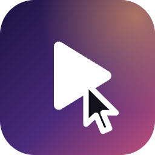
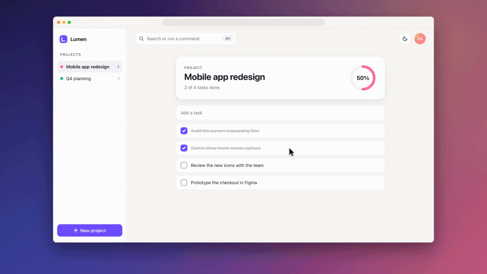
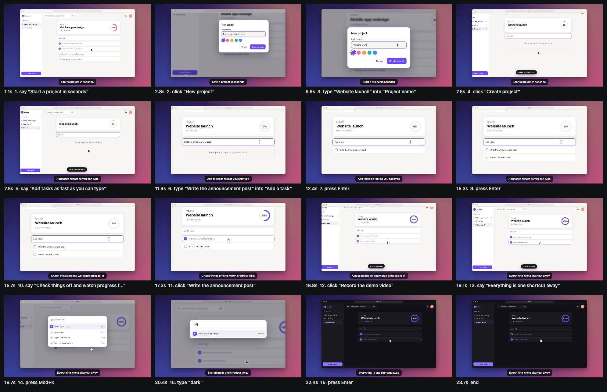
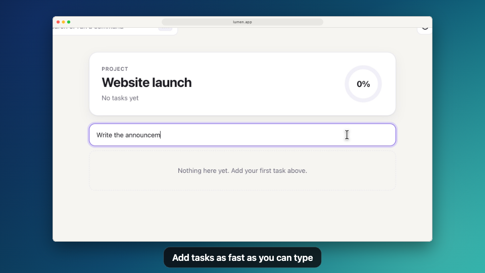
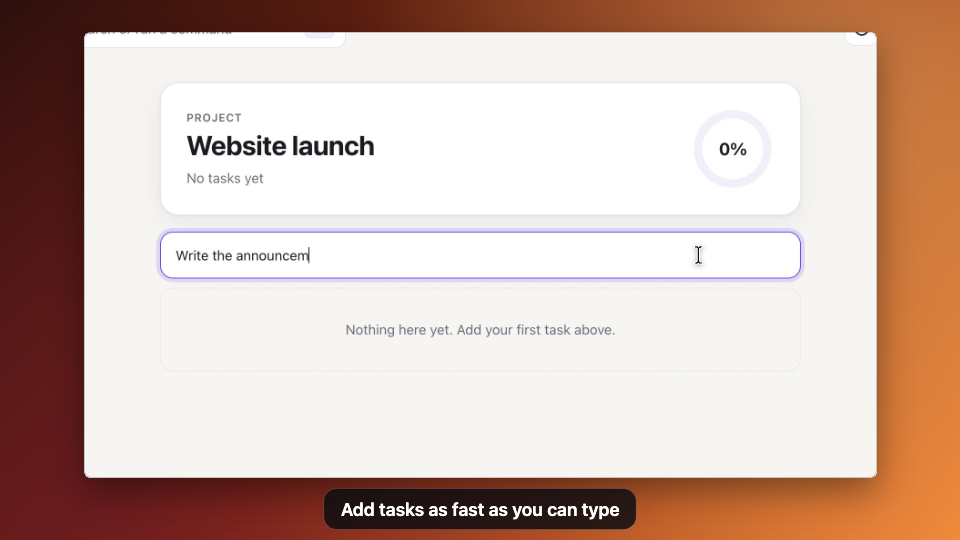
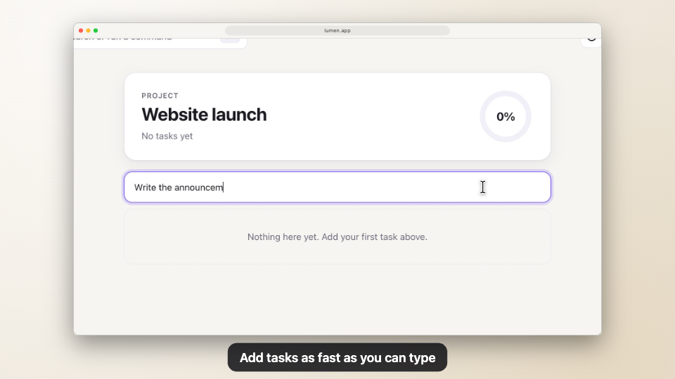
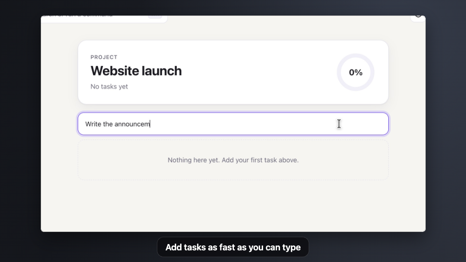
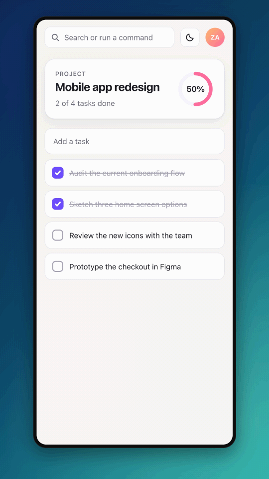

<div align="center">



# Demoreel

**Your coding agent records the demo video.**

Ask Claude Code or Codex for a demo of your app. It writes a short storyboard, drives your real app in a headless browser, and hands back a polished video: smooth cursor, zoom on every action, captions, MP4 and GIF.

[](#install)
[](#install)
[](https://github.com/zainulabdn/demoreel/actions/workflows/test.yml)
[](CHANGELOG.md)
[](LICENSE)
[](https://nodejs.org)
[](#how-it-works)

[Install](#install) · [Quick start](#quick-start) · [The storyboard](#this-file-made-that-video) · [Features](#features) · [Looks](#looks) · [How it works](#how-it-works) · [FAQ](#faq)

</div>

<p align="center">
  
</p>
<p align="center"><sub>Nobody recorded or edited this. It was made from the 16-step file <a href="#this-file-made-that-video">below</a>, in about 35 seconds. <a href="docs/media/demo.mp4">Watch the full-quality MP4</a>.</sub></p>

## Why Demoreel?

Every project needs a demo video: for the README, the launch post, the pull request. Making one means opening a screen recorder, rehearsing the clicks, re-recording when you fumble, then editing in zooms and captions. Then the UI changes and the video is out of date.

Demoreel makes the video a file in your repo. Your agent reads the app, writes the steps, records, and checks the result itself. When the app changes, you run it again.

- **For launches:** a clean 20-second clip for X, LinkedIn and Product Hunt, without touching a video editor.
- **For READMEs:** a GIF that shows what the project does, regenerated whenever the UI moves.
- **For pull requests:** "here is the new flow" as a video the reviewer can watch in ten seconds.

## Install

You need [Node.js 20+](https://nodejs.org) and a Chromium-based browser (Google Chrome, Microsoft Edge or Brave). That is all: no Playwright, no ffmpeg, no `npm install`, no API key.

### Claude Code

```bash
claude plugin marketplace add zainulabdn/demoreel
claude plugin install demoreel@demoreel
```

### Codex

```bash
codex plugin marketplace add zainulabdn/demoreel
codex plugin add demoreel@demoreel
```

Or in the Codex app: **Plugins**, **Add a marketplace**, enter `zainulabdn/demoreel`, then install **Demoreel**.

### Cursor, Gemini CLI and other agents

Demoreel is a standard [Agent Skill](https://agentskills.io), so the skills installer works:

```bash
npx skills add zainulabdn/demoreel
```

### No agent at all

It is also a plain command-line tool. See [Use it by hand](#use-it-by-hand).

## Quick start

Open your project and ask in plain words:

```
Make a demo video of this app
```

```
Record a GIF of the checkout flow for the README
```

```
Make a vertical demo of the mobile layout for LinkedIn
```

The agent finds how your app starts, reads the screens for the flow, writes `demo.reel.json`, checks that every step works, records, looks at the result, and fixes what is off. You get:

| File | What it is |
|---|---|
| `demo.mp4` | H.264 video, 1080p by default. Plays everywhere, and stays under GitHub's 10 MB upload limit. |
| `demo.gif` | Looping GIF that embeds straight into a README. |
| `demo.poster.png` | A still frame for thumbnails and link previews. |
| `demo.sheet.png` | A contact sheet: one frame per step. This is how the agent checks its own work. |

The contact sheet for the video above. One frame per step, with the step and its time underneath:

<p align="center">
  
</p>

## This file made that video

A storyboard is a list of steps in plain language. Elements are named the way a person sees them: the text on a button, the label on a field. No selectors, no test IDs, no code.

```json
{
  "serve": ".",
  "displayUrl": "lumen.app",
  "style": { "background": "dusk" },
  "steps": [
    { "say": "Start a project in seconds" },
    { "click": "New project" },
    { "type": "Website launch", "into": "Project name" },
    { "click": "Create project" },

    { "say": "Add tasks as fast as you can type" },
    { "type": "Write the announcement post", "into": "Add a task" },
    { "press": "Enter" },
    { "type": "Record the demo video" },
    { "press": "Enter" },

    { "say": "Check things off and watch progress fill in" },
    { "click": "Write the announcement post" },
    { "click": "Record the demo video" },

    { "say": "Everything is one shortcut away" },
    { "press": "Mod+K" },
    { "type": "dark" },
    { "press": "Enter", "pause": 1400 }
  ]
}
```

That is the whole input. The cursor paths, the typing rhythm, when to zoom in, where to look and when to pull back are worked out for you. The app and storyboard are in [`examples/lumen`](examples/lumen); run `npm run demo` to make the video yourself.

All steps and options: [Storyboard reference](skills/demoreel/references/storyboard.md).

## Features

<table>
<tr>
<td width="50%" valign="top">

**🎬 Your real app, not a mockup**<br>
It opens the app you actually built and uses it. What you see in the video is what a user gets.

</td>
<td width="50%" valign="top">

**🖱️ A cursor that moves like a hand**<br>
Curved paths with a soft start and stop, a click ripple, and the right pointer for the job: arrow, hand, text bar, or a touch dot on phones.

</td>
</tr>
<tr>
<td valign="top">

**🔍 A camera that follows the story**<br>
It zooms in as the cursor arrives, stays while you type, then follows what changed: the dialog that opened, the row that appeared, the toast at the bottom.

</td>
<td valign="top">

**💬 Captions built in**<br>
One `say` step puts a caption under the video, so it makes sense with the sound off. They sit below the app and never cover it.

</td>
</tr>
<tr>
<td valign="top">

**🗣️ Steps in plain words**<br>
`click "New project"`, `type into "Email"`. When a name is wrong, the error says "Did you mean …?" and lists what is on screen.

</td>
<td valign="top">

**✅ It checks its own work**<br>
`check` runs the steps in seconds and screenshots each one. After recording, a contact sheet shows a frame per step, so the agent can see what it made and fix it.

</td>
</tr>
<tr>
<td valign="top">

**📱 Every shape you post in**<br>
1080p for READMEs and X, square for LinkedIn, vertical for Reels and Shorts. A browser, window or phone frame, and eight backgrounds or your own colours.

</td>
<td valign="top">

**⚡ Nothing to install**<br>
Zero dependencies. It drives the Chrome you already have and encodes MP4 and GIF inside it. A 24-second 1080p video takes about 35 seconds on a recent MacBook.

</td>
</tr>
</table>

Plus: restyle a recording in seconds without recording again (`render`), start your dev server for you (`start`), serve a static build (`serve`), dark mode (`theme`), secrets from environment variables (`${env:PASSWORD}`), and automatic hiding of framework dev overlays.

## Looks

The same recording, four styles. Change `style` and re-render; no need to record again.

| | |
|---|---|
|  <br><sub>`"background": "ocean"`</sub> |  <br><sub>`"background": "ember", "frame": "window"`</sub> |
|  <br><sub>`"background": "paper"`</sub> |  <br><sub>`"background": "slate", "frame": "window"`</sub> |

And for phones, `"viewport": "phone"` with `"output": { "size": "vertical" }`:

<p align="center">
  
</p>

## Demoreel, a screen recorder, or a mockup animator?

They make different things. Pick by what you need.

| | **Demoreel** | **Screen recorders** <br><sub>Screen Studio, OpenScreen, Loom</sub> | **Mockup animation tools** | **Playwright's built-in video** |
|---|---|---|---|---|
| **What is recorded** | Your real web app | Anything on your screen | A redrawn version of your UI | Your real web app |
| **Who performs it** | Your agent, from a storyboard | You, live | Nobody: it is animated | A test script |
| **When the UI changes** | Run it again | Record and edit again | Redraw it | Run it again |
| **Cursor, zoom, captions** | Automatic | Zoom is automatic in some; captions, trims and retakes are by hand | Designed by hand | None: raw page video |
| **Voice-over and audio** | No | Yes | Varies | No |
| **Native apps** | No | Yes | Yes | No |

**Pick Demoreel** when the demo should stay true to the app and be redone with one command. **Pick a screen recorder** when you want to talk over it, or the app is not on the web. **Pick a mockup tool** when the product is not built yet.

## How it works

Two passes, both in a headless copy of the Chrome on your machine. Demoreel talks to it directly over the Chrome DevTools Protocol through a private pipe.

```
demo.reel.json
      │
      ▼
 1. Record   The app is opened at 2x pixel density. Each step is performed with real
             mouse and keyboard input while frames are captured. Every cursor position,
             click, caption and page change is written to a timeline.
      │
      ▼
 2. Render   The timeline becomes camera moves (a spring, so they ease in and out).
             Each frame is drawn on a canvas: background, window, zoomed page, cursor,
             caption. The browser's own H.264 encoder writes the MP4; a small built-in
             encoder writes the GIF.
      │
      ▼
 demo.mp4   demo.gif   demo.poster.png   demo.sheet.png
```

Because recording and rendering are separate, the look can change without touching the app again.

**Zero dependencies** means exactly that: `package.json` has none. The MP4 container writer and the GIF encoder are a few hundred lines each, in this repo, with tests. If your browser has no H.264 encoder (plain Chromium builds do not), Demoreel uses `ffmpeg` when it is installed and says so when it is not.

## Use it by hand

```bash
git clone https://github.com/zainulabdn/demoreel
cd demoreel
node skills/demoreel/scripts/demoreel.mjs doctor                           # can this machine record?
node skills/demoreel/scripts/demoreel.mjs init                             # writes a starter demo.reel.json
node skills/demoreel/scripts/demoreel.mjs check demo.reel.json             # run the steps, no video
node skills/demoreel/scripts/demoreel.mjs record demo.reel.json            # make the video
```

| Command | What it does |
|---|---|
| `check <storyboard>` | Runs the steps fast and reports the first one that fails, with suggestions and a screenshot. |
| `record <storyboard>` | Records and renders. `--keep` saves the raw recording. `--out <dir>`, `--formats mp4,gif`, `--json`. |
| `render <recording>` | Renders a kept recording again with a new style. `--storyboard <file>` to take the style from. |
| `doctor` | Checks Node, the browser, and video encoding. |
| `init [file]` | Writes a starter storyboard. |

## Privacy

- Everything runs on your machine. Demoreel makes no network requests of its own and sends nothing anywhere. The browser loads only the app you point it at.
- Each run uses a fresh, temporary browser profile: none of your cookies, logins or history, and it is deleted afterwards.
- The local server that passes frames to the renderer listens on `127.0.0.1` only, on a random port, behind a one-time token.
- The video shows whatever is on the page. Record with test accounts and made-up data.

## Limits

Version 0.1 is deliberately small. It does not do:

- Native mobile or desktop apps. Web only.
- Audio or voice-over.
- Links that open in a new tab, content inside iframes, or file uploads.
- Native HTML5 drag-and-drop (pointer-based dragging works).
- Canvas-only apps such as games and map editors, which have no elements to name.

## FAQ

**Does it need an API key or cost anything?**<br>
No. Demoreel calls no AI. The agent you already use writes the storyboard; Demoreel only records and renders. Without an agent you write the storyboard yourself.

**Which frameworks work?**<br>
Anything that renders ordinary HTML in Chrome, whatever built it: React, Next.js, Vue, Nuxt, Svelte, Astro, Angular or plain HTML. So far it has been tested against a plain JavaScript app and a React app with controlled inputs and client-side routing. If your framework trips it up, please open an issue.

**My app needs a login. Now what?**<br>
Add sign-in as the first steps with a test account, and keep the password out of the file: `{ "type": "${env:DEMO_PASSWORD}", "into": "Password" }`. Password fields show dots in the video as usual.

**How do I put the video in my README?**<br>
The GIF embeds directly: ``. For the MP4, GitHub only plays videos uploaded through its editor: open the README on github.com, drag the MP4 in, and commit the link it creates. The MP4 is kept under 10 MB so that works on free accounts.

**The camera zoomed on the wrong thing.**<br>
Add `"zoom": false` to that step to keep it wide, or `{ "zoom": "out" }` before it. See [Directing a demo](skills/demoreel/references/directing.md).

**Can it run in CI, so the demo never goes stale?**<br>
Yes. GitHub's runners ship with Chrome. Set `"start"` or `"serve"` in the storyboard and run `record` in a workflow. In containers, set `DEMOREEL_NO_SANDBOX=1`.

**Something failed and the message does not help.**<br>
Run `doctor`, then see [Troubleshooting](skills/demoreel/references/troubleshooting.md).

## Contributing

Issues and pull requests are welcome, especially new backgrounds, frames and step types. `npm test` runs everything; the browser tests need Chrome and take about a minute. See [CONTRIBUTING.md](CONTRIBUTING.md).

## License

[MIT](LICENSE) © [Zain Ul Abideen](https://github.com/zainulabdn)
